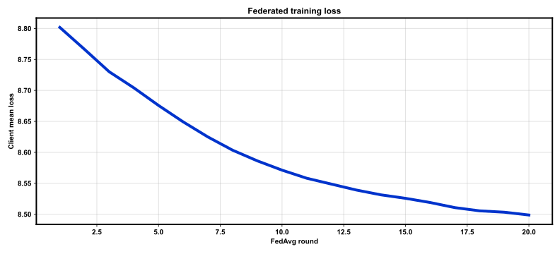
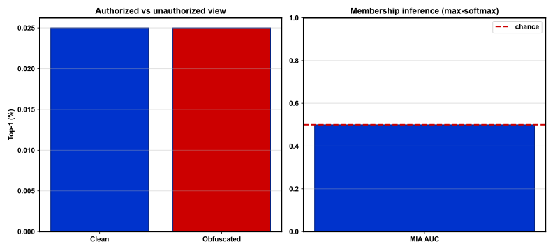

# REPORT: Federated Input-Level Privacy — full

**Protocol:** `full`  
**Package:** `flpriv`  

## Summary

| Metric | Value |
|--------|-------|
| LFW accuracy | 53.58% |
| LFW EER | 46.42% |
| MIA AUC (max-softmax) | 0.4996 |
| Clean top-1 | 0.03% |
| Obfuscated top-1 (no inverse) | 0.03% |

## Training

- Rounds: 20
- Clients: 4
- Train images: 141610
- Identities: 7124
- n-CutMix / grid G: 2 / 4
- Elapsed: 1941.79 s
- Checkpoint: `outputs/checkpoints/full/last.pt`

## Figures

### `train_loss.svg`



### `privacy_metrics.svg`



## Reproduce

```bash
bash scripts/smoke.sh
bash scripts/train_full.sh
```

## Notes

- CelebA partitioned by identity for FedAvg; LFW for verification.
- PubFig/PINS omitted (see DEVIATIONS.md).
